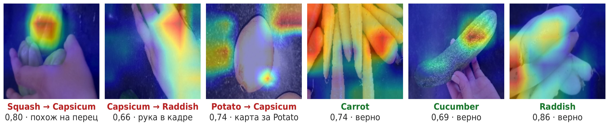

# Классификатор овощей (трек A)

Модель узнаёт на фото один из шести овощей: Capsicum, Carrot, Cucumber, Potato, Raddish, Squash.
Это сеть EfficientNet-B0, уже обученная на миллионе картинок ImageNet, которую я доучил на датасете
[preethi866/vegetable-dataset](https://www.kaggle.com/datasets/preethi866/vegetable-dataset).

**Отчёт на 2 страницы:** [REPORT.pdf](REPORT.pdf) — что я нашёл в данных, что сделал, итоговые метрики,
что не получилось и что дальше.

## Главный результат

Почти весь датасет (95%) — кадры 19 видео, а соседние кадры почти одинаковые. Поэтому я проверяю
честно: делю данные целыми видео, и каждое фото проверяет модель, которая его видео не видела.

| Проверка | Accuracy | Macro-F1 |
| --- | --- | --- |
| Моя: по видео, все 3 879 фото | 0,937 | 0,920 |
| Автора датасета: его train → его test | 1,000 | 1,000 |

Accuracy — доля верных ответов. Macro-F1 — средняя оценка по классам, где каждый класс весит одинаково.

100% на тесте автора — не качество, а утечка: 717 из 799 его тестовых фото лежат и в обучающей части.

Если модель уже видела этот овощ в тот же день съёмки, она права в 98% случаев, а если день новый —
в 79,5%. В магазине каждый день новый, поэтому там честнее ждать около 80%.

На 37 своих фото из магазина Magnum модель права в 24 случаях. Сорта, которые есть в датасете, она
узнаёт (24 из 28), а кабачок и зелёную редьку — нет (0 из 9): в датасете под Squash и Raddish лежат
чайот и дайкон. Фото и как их проверить — в разделе [«Проверка на своих фото»](#проверка-на-своих-фото).

Сделаны оба бонуса трека A: ответ `unknown`, когда модель не уверена, и экспорт в ONNX (разделы ниже).

## Как запустить predict.py

```bash
pip install -r requirements.txt
python predict.py --input путь/к/папке --output preds.csv
```

* Работает на обычном процессоре, интернет не нужен. Веса лежат в `weights/model.pt` (16 МБ).
* Фото во вложенных папках тоже обрабатываются, файлы, которые не картинки, пропускаются.
* В `preds.csv` три колонки: `filename` — путь к фото внутри папки, `label` — класс или `unknown`,
  `confidence` — уверенность модели от 0 до 1 (вероятность самого вероятного класса, у `unknown` тоже).
* Если уверенность ниже 0,45, ответ `unknown`: такое фото лучше показать человеку. Как выбран порог —
  в разделе «Бонус 1». `--unknown-threshold 0` выключает `unknown`, и модель всегда называет один из шести классов.
* Если файл не читается, он получает `unknown` с уверенностью 0, а остальные фото обрабатываются дальше.
* Фото iPhone в формате HEIC читаются, если поставить `pip install pillow-heif`.
* `--onnx` — считать через ONNX Runtime вместо PyTorch: ответы те же, сеть в 2–3 раза быстрее.
  Нужен `pip install onnxruntime`, файл `weights/model.onnx` уже лежит в репозитории.
* Другие параметры: `--weights` — другой файл весов, `--batch` — сколько фото за раз (по умолчанию 16),
  `--threads` — сколько потоков процессора, `--benchmark N` — замерить время одной только сети.

**Время на одно фото** (процессор Intel Xeon 2,3 ГГц, 2 потока, фото по одному; разброс 4 запусков):

| Что | PyTorch | ONNX Runtime (`--onnx`) |
| --- | --- | --- |
| Только сеть | 16–23 мс | 6–7 мс |
| Кадр 200×200 вместе с чтением файла | 18–24 мс | 12–13 мс |
| Фото 10 Мп вместе с чтением файла | 73–88 мс | 66–73 мс |

На больших фото почти всё время уходит на чтение JPEG, поэтому ONNX там почти не ускоряет.
Фото HEIC 24 Мп с iPhone читаются около 0,6 с.

## Проверка на своих фото

Чтобы проверить модель на настоящих фото с iPhone (HEIC), я сходил в Magnum и снял овощи на полках.
Дайкона там не нашлось — вместо него на экзамен пришла зелёная редька, а Squash я снял кабачком, как в ТЗ.
Дайкон и чайот, которые лежат в датасете, пришлось взять из интернета.

Фото лежат в папке [`veg_test/`](veg_test) (113 МБ): `my_photos/` — 37 фото из Magnum в исходном виде
(HEIC), `web_photos/` — 19 картинок из интернета, `labels.csv` — что на каждом фото, а для картинок
с Wikimedia ещё автор и лицензия.

Из папки с кодом запустите:

```bash
pip install pillow-heif
python predict.py --input veg_test/my_photos --output veg_test/my_preds.csv
python check_my_photos.py veg_test/my_preds.csv
```

`check_my_photos.py` сверяет ответы с папками классов и отдельно считает верные ответы, ошибки и `unknown`.
Для картинок из интернета то же самое с `veg_test/web_photos`.

| Фото | Без порога: верно | С порогом 0,45: верно / ошибок / `unknown` |
| --- | --- | --- |
| 28 своих: сорта из датасета | 24 из 28 | 22 / 2 / 4 |
| 9 своих: кабачок и зелёная редька | 0 из 9 | 0 / 4 / 5 |
| 19 из интернета | 16 из 19 | 14 / 0 / 5 |

Из интернета модель узнала все 6 фото дайкона и чайота, а ошиблась на тыкве (другой сорт Squash),
моркови с ботвой и картофеле на рынке — все три ответа неуверенные, и с порогом они становятся `unknown`.

## Grad-CAM: куда смотрит модель



Красным подписаны ошибки (верный класс → ответ модели, уверенность), зелёным — верные ответы. Каждое фото
разбирает модель, которая не видела его видео. На верных ответах модель смотрит на сам овощ. Ошибки трёх
видов: похожий зелёный овощ (чайот → перец), овощ почти не виден (рука → Raddish) и опора на фон: у
картофеля показана карта за верный класс, и она лежит на столешнице. Все 12 примеров —
в [results/gradcam_grid.png](results/gradcam_grid.png) и в ноутбуке с выводами.

## Бонус 1: unknown

Модель всегда выбирает один из шести классов, даже если на фото пустая полка или другой овощ. Поэтому
`predict.py` отвечает `unknown`, если уверенность ниже порога. Чем выше порог, тем меньше ошибок,
но тем больше верных ответов тоже становятся `unknown`.

**Как выбран порог 0,45** (`python choose_threshold.py`):

1. **Данные.** Out-of-fold ответы на 3 879 фото датасета (`results/oof_preds.csv`): каждое фото
   предсказала модель, которая не видела его видео. Свои фото в выборе не участвовали, только в проверке.
2. **Правило.** Ошибка стоит 5, `unknown` стоит 1 (фото уходит человеку), верный ответ — 0. Беру порог
   с самой низкой суммой. Соотношение 5:1 взято из ТЗ: в бонусе трека B ответ «овощ есть», когда его нет,
   стоит магазину в 5 раз дороже ложной тревоги.
3. **Сетка** с шагом 0,05: точнее подбирать по этим данным нет смысла.

| Порог | Отвечает на | Верно среди ответов | Ошибок осталось из 245 | Верных стало `unknown` | Цена |
| --- | --- | --- | --- | --- | --- |
| без порога | 100% | 93,7% | 245 | 0 | 1 225 |
| 0,40 | 93,6% | 96,6% | 123 | 125 | 862 |
| **0,45** | **89,0%** | **98,1%** | **66** | **247** | **756** |
| 0,50 | 84,6% | 98,8% | 41 | 392 | 801 |
| 0,60 | 72,6% | 99,4% | 17 | 835 | 1 148 |

* Если ошибка дороже `unknown` в 3 раза, порог выходит 0,40, если в 10 раз — 0,50.
* На каждой половине данных по отдельности выходит 0,45 и 0,50, то есть выбор устойчивый.
* При честных вероятностях порог был бы 0,8 (отвечать, если 5 × (1 − p) < 1). Но модель недооценивает
  себя из-за label smoothing: среди ответов с уверенностью 0,45–0,50 верны 85%.

**Проверка на своих фото** (таблица — в разделе [«Проверка на своих фото»](#проверка-на-своих-фото)):
на 37 фото из Magnum с порогом ошибок стало 6 вместо 13, а 9 фото ушли в `unknown`; на 19 картинках
из интернета ошибок не осталось совсем. Из 9 фото незнакомых сортов (кабачок и зелёная редька) порог
отправил в `unknown` 5. Кабачки, которые модель уверенно называет огурцом (0,72 и 0,80), он не ловит.

**Ограничения.** В датасете нет фото без этих шести овощей, поэтому порог подобран только по ним.
Уверенность — слабый признак «чужого» объекта: уверенные ошибки на незнакомых овощах остаются.
Следующий шаг — снять в магазине пустые полки и другие овощи и обучить отдельный класс «другое».

## Бонус 2: ONNX

```bash
pip install -r requirements-onnx.txt
python export_onnx.py --check-dir папка/с/фото
```

`export_onnx.py` сохраняет сеть из `weights/model.pt` в `weights/model.onnx`, сверяет ответы
ONNX Runtime и PyTorch и замеряет скорость обоих на одном процессоре с одинаковым числом потоков.

* **Ответы совпадают.** На 344 фото (снимки датасета, свои фото из магазина и фото из интернета)
  ответ одинаковый у всех, вероятности расходятся не больше чем на 0,000002.
  `predict.py --onnx` пишет тот же CSV, что и без него.
* **Скорость сети** (без чтения фото, медиана 5 запусков):

| Пачка | PyTorch | ONNX Runtime | Быстрее |
| --- | --- | --- | --- |
| 1 фото | 21,7 мс | 6,6 мс | в 3,3 раза |
| 16 фото, время на одно | 15,7 мс | 7,5 мс | в 2,1 раза |

* **Размер.** Файл модели почти тот же (15,8 МБ против 15,6 МБ), но для запуска хватает onnxruntime:
  74 МБ против 1,2 ГБ у PyTorch, к которому pip на Linux добавляет ещё около 3 ГБ библиотек CUDA.
* На виртуальной машине замеры гуляют на ±20%, поэтому в таблице медианы.
  Последний замер записан в `results/onnx_benchmark.json`.

## Что лежит в репозитории

| Файл | Зачем |
| --- | --- |
| `REPORT.pdf` | Отчёт на 2 страницы |
| `audit_dataset.py` | Проверка данных: размеры, копии, похожие снимки |
| `check_author_split.py` | Проверка разбиения автора: сколько его тестовых фото есть в обучении |
| `make_splits.py` | Моё разбиение на две половины по видео → `splits.csv` |
| `splits.csv`, `author_split.csv` | Моё разбиение и разбиение автора |
| `common.py` | Общий код: классы, чтение и подготовка фото, модель |
| `train.py` | Обучение и подсчёт метрик |
| `gradcam.py` | Картинки Grad-CAM: куда смотрит модель |
| `predict.py` | Ответы для папки с фото |
| `check_my_photos.py` | Сверка ответов `predict.py` с папками классов: проверка на своих фото |
| `choose_threshold.py` | Подбор порога для `unknown` |
| `export_onnx.py` | Экспорт в ONNX, сверка ответов и замер скорости |
| `kaggle_train.ipynb` | Всё обучение одним ноутбуком на Kaggle |
| `notebookc5ef04bfb5.ipynb` | Тот же ноутбук с выводами моего запуска на Kaggle: метрики, матрицы ошибок, Grad-CAM |
| `results/` | Out-of-fold ответы, таблица порогов, замер ONNX, картинки Grad-CAM |
| `weights/model.pt`, `weights/model.onnx` | Веса готовой модели для PyTorch и для ONNX Runtime |
| `requirements.txt`, `requirements-train.txt`, `requirements-onnx.txt` | Библиотеки для `predict.py`, для обучения и для ONNX |
| `veg_test/` | Мои 37 фото из Magnum (HEIC) и 19 картинок из интернета для проверки на своих снимках |

## Как повторить всё с нуля

### 1. Скачать данные

Скачайте архив со [страницы датасета](https://www.kaggle.com/datasets/preethi866/vegetable-dataset)
(кнопка Download) и распакуйте в папку `data_raw/`. Должно получиться так:

```
data_raw/Dataset/Dataset/<Класс>/*.jpg
data_raw/final_dataset/final_dataset/{train,val,test}/<Класс>/*.jpg
```

### 2. Проверить данные (около 2 минут на процессоре)

```bash
pip install -r requirements-train.txt
python audit_dataset.py --data data_raw --out audit_out
python check_author_split.py --inventory audit_out/inventory.csv
```

Первый скрипт пишет сводку в `audit_out/summary.txt`. Второй печатает, сколько тестовых фото автора
повторяются в его обучающей части.

### 3. Разделить данные

```bash
python make_splits.py --data data_raw --out splits.csv
```

Нужен scikit-learn 1.8 или новее: в старых версиях есть ошибка, из-за которой разбиение получается
другим. С новой версией файл совпадает с `splits.csv` из репозитория байт в байт (проверено на Windows
и Linux).

### 4. Обучить модель

Проще всего на Kaggle, там бесплатная видеокарта:

1. Импортируйте `kaggle_train.ipynb`.
2. Добавьте датасет: Input → Add Input.
3. Включите GPU T4 и интернет.
4. Нажмите Run All. Всё займёт около 20–25 минут.

Ноутбук сам скачивает этот репозиторий и запускает те же команды, что ниже. Выводы моего запуска
можно посмотреть без запуска в `notebookc5ef04bfb5.ipynb`. Чтобы обучить у себя
(лучше с видеокартой, на процессоре это намного дольше):

```bash
python train.py --data data_raw --splits splits.csv --test-fold 0 --out runs/fold0
python train.py --data data_raw --splits splits.csv --test-fold 1 --out runs/fold1
python train.py --data data_raw --splits author_split.csv --train-folds train --test-fold test --out runs/author
python train.py --data data_raw --splits splits.csv --test-fold none --out runs/final
python gradcam.py --data data_raw --runs runs --out runs/gradcam
```

* `fold0` и `fold1` — две модели: каждая учится на одной половине данных и проверяется на другой.
  Общий итог по всем фото считает ячейка «Итог по обоим фолдам» в ноутбуке, она же сохраняет
  out-of-fold ответы в `runs/oof_preds.csv`.
* `author` — та же модель на разбиении автора, только для сравнения.
* `final` — модель на всех фото. Её файл `runs/final/model.pt` надо скопировать в `weights/model.pt`.

Как учу: сначала 2 эпохи (прохода по всем фото) учится только последний слой, потом 6 эпох вся сеть
маленькими шагами. Повторные запуски дают те же ответы на всех проверочных фото.

### 5. Порог unknown и ONNX

```bash
python choose_threshold.py --oof runs/oof_preds.csv
pip install -r requirements-onnx.txt
python export_onnx.py
```

Без `--oof` скрипт берёт `results/oof_preds.csv` из репозитория.

## Версии библиотек

* `predict.py`: в пустом окружении `pip install -r requirements.txt` поставил torch 2.15.0,
  torchvision 0.29.2 и Pillow 13.0.0 (Linux, Python 3.13), и скрипт отработал. На Linux pip вместе с
  torch скачивает библиотеки для видеокарты (около 4 ГБ); работать на процессоре это не мешает.
  Скачать меньше можно, если сначала поставить версию только для процессора:
  `pip install torch torchvision --index-url https://download.pytorch.org/whl/cpu`.
* ONNX: onnx 1.23.2, onnxscript 0.7.2, onnxruntime 1.32.0 (`requirements-onnx.txt`).
* Фото HEIC: pillow-heif 1.8.1.
* Обучение шло на Kaggle (GPU Tesla T4) со scikit-learn 1.8 или новее. Точные версии остальных
  библиотек печатает первая ячейка `kaggle_train.ipynb`.
* Остальные скрипты проверены на процессоре с torch 2.15.0, torchvision 0.29.2, scikit-learn 1.9.1,
  numpy 2.5.3, pandas 3.0.5, matplotlib 3.11.2.
